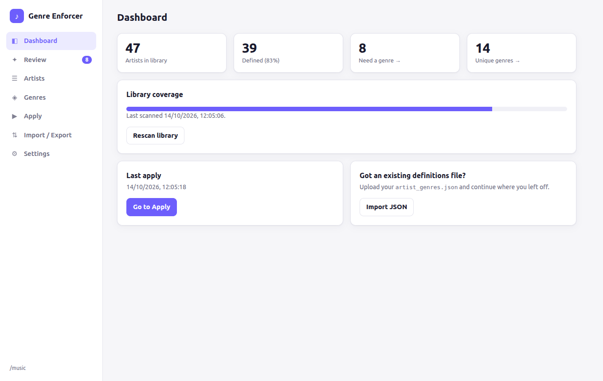
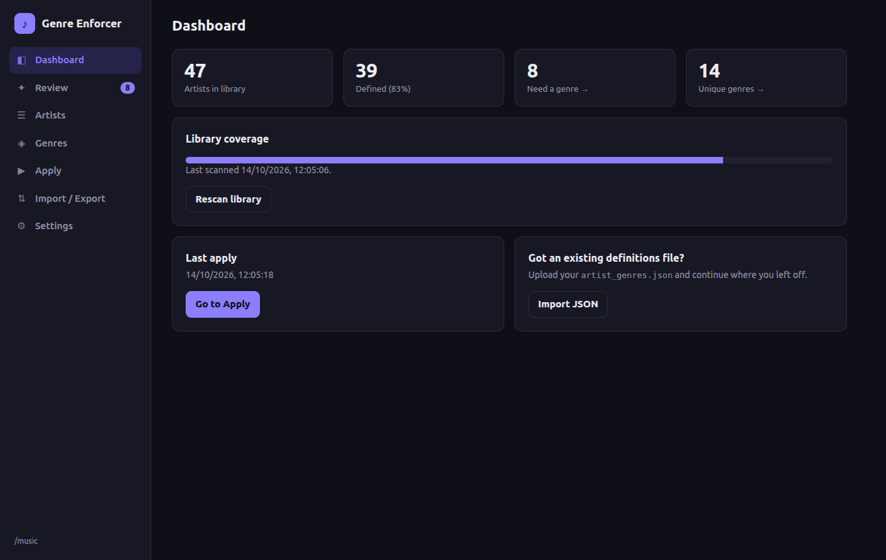
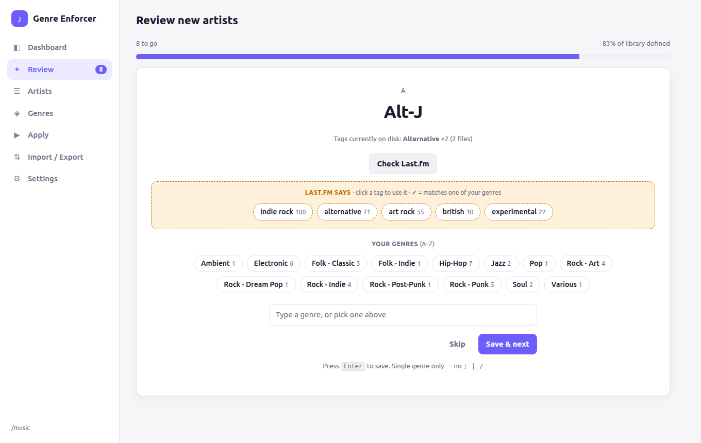
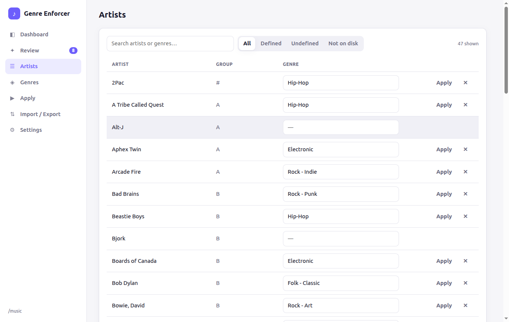
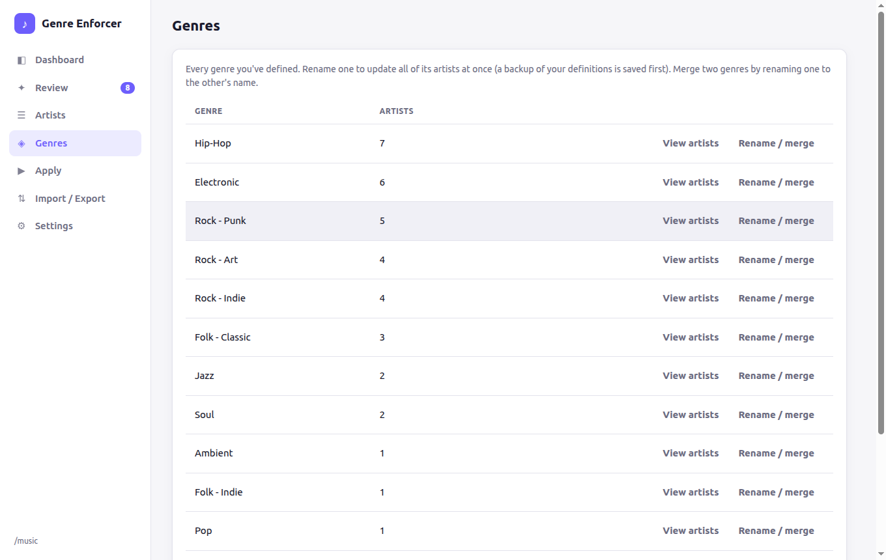
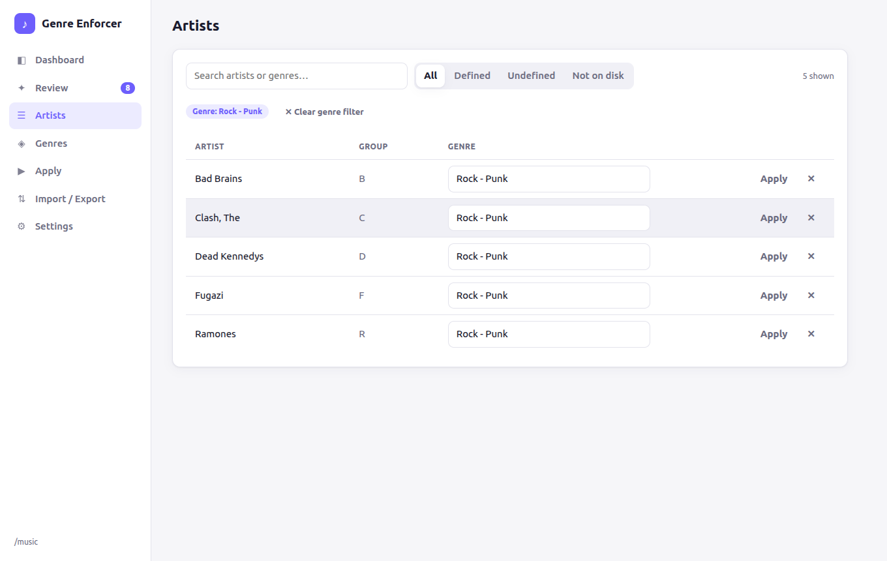
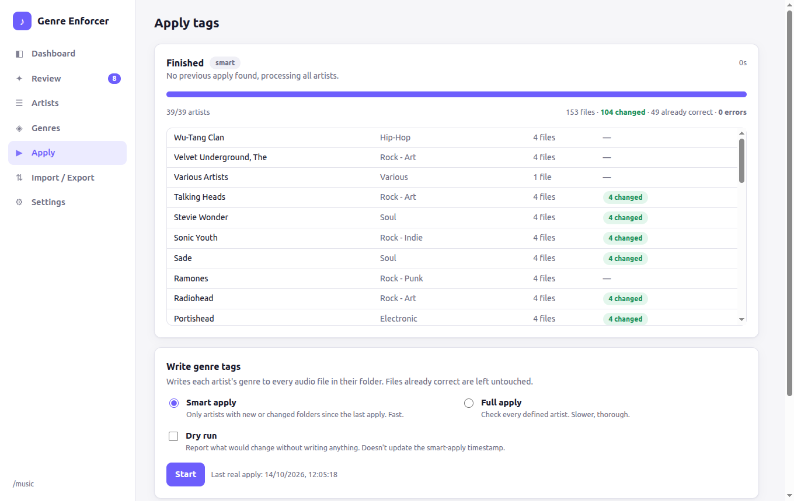
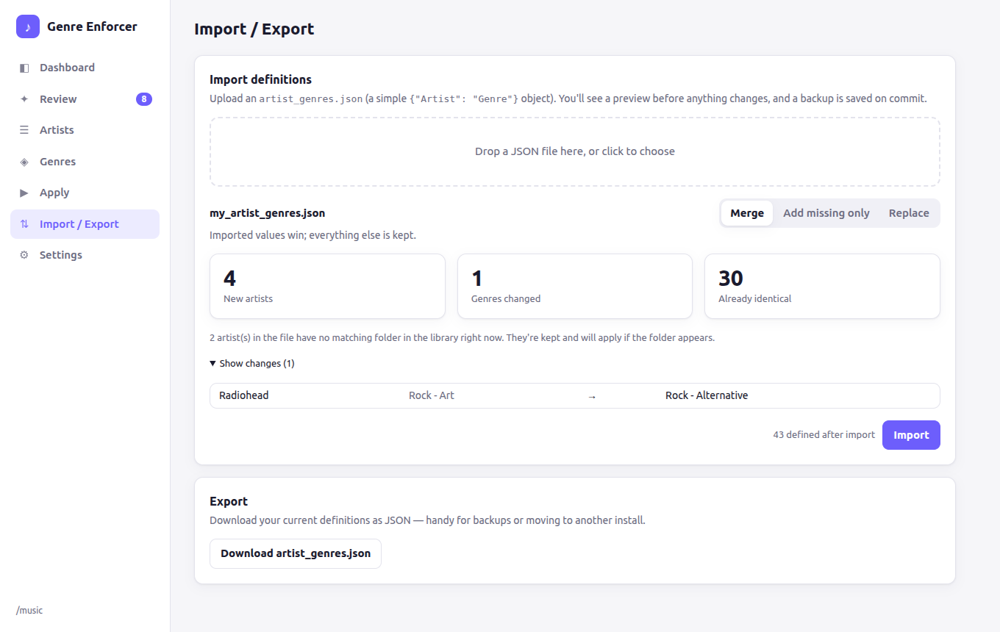
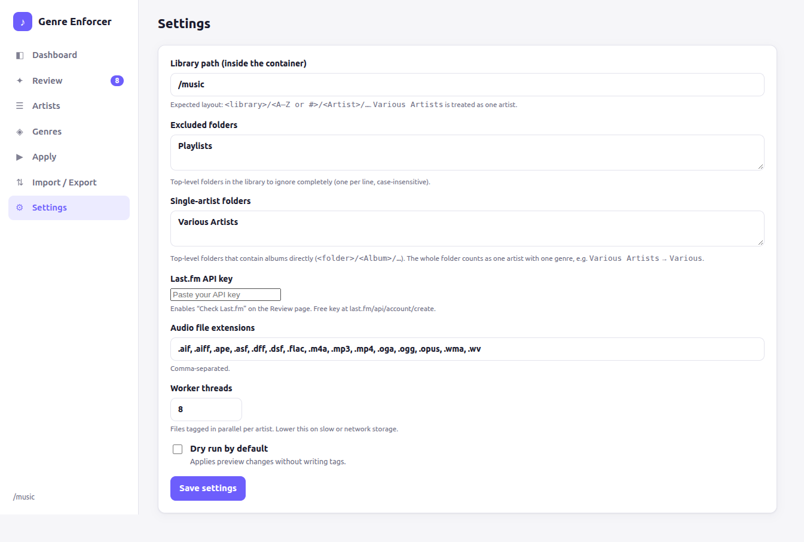
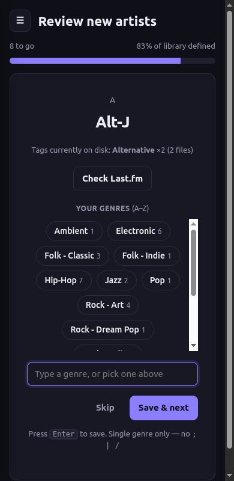

# 🎵 Artist Genre Metadata Enforcer

[](LICENSE)
[](https://hub.docker.com/r/wb20244/music-genre-enforcer)
[](https://buymeacoffee.com/succinctrecords)

**Your music library, your rules.**

A self-hosted web app that enforces **your personal genre definitions** across your music library. You decide each *artist's* genre once; the app writes it to the `GENRE` tag of every file by that artist. No more `Hip Hop` / `Hiphop` / `Hip-hop` / `Rap` / `Boom Bap` scattered across the same artist's albums, and no outsourcing a subjective opinion to MusicBrainz or Last.fm.

It runs as a single Docker container: a small Python (FastAPI) backend that does the work and serves the web UI. It is **not** a MusicBrainz Picard plugin. Tag with Picard (or anything else) first, then let this overwrite the genre field afterwards.

---

## 🚀 Quick start (Docker)

You need Docker with Compose, and a music library laid out as in [How it works](#-how-it-works). The image is currently built for **linux/amd64** only.

**docker compose** (recommended). Save as `compose.yaml`:

```yaml
services:
  music-genre-enforcer:
    image: wb20244/music-genre-enforcer:latest
    container_name: music-genre-enforcer
    user: "1000:1000"                 # a user that can WRITE to your music files
    environment:
      - TZ=Europe/London              # optional
    volumes:
      - ./config:/config              # your definitions, settings, history, backups
      - /path/to/your/music:/music    # your library (must be writable)
    ports:
      - 8320:8320
    restart: unless-stopped
```

```bash
docker compose up -d
```

**or plain `docker run`:**

```bash
docker run -d --name music-genre-enforcer --restart unless-stopped \
  --user 1000:1000 -p 8320:8320 \
  -v "$PWD/config:/config" -v /path/to/your/music:/music \
  wb20244/music-genre-enforcer:latest
```

Then open **http://\<your-host\>:8320**.

| Setting | What it is |
|---|---|
| `/music` | Your library. Mount it **read-write**; tags are written in place. |
| `/config` | Everything the app saves (see [Config & data](#-config--data)). Keep this on persistent storage. |
| `user:` | Must match a user that owns/can write your music files (find yours with `id`). Run `ls -ln` on your library to see the owner's numeric uid/gid. |
| `8320` | Web UI port. |

> ⚠️ **There is no login.** The app writes tags to your library, so keep it on your LAN or put it behind a reverse proxy with authentication. Do not expose it to the internet.

### First run

1. Open the app. If your library isn't at `/music`, change **Settings → Library path**.
2. **Already have an `artist_genres.json`** (from the old terminal version, or another install)? Go to **Import / Export** and upload it. You get a preview of what will be added or changed, and a backup is taken when you commit.
3. Go to **Review**. You're shown one undefined artist at a time, along with the genres currently on its files. Click one of your existing genres or type a new one, and press **Enter**.
4. Not sure what to pick? Set a [Last.fm API key](#-settings) and click **Check Last.fm** for the genres Last.fm lists for that artist.
5. Switch on **Dry run**, then go to **Apply** to preview what *would* change. When you're happy, turn dry run off and run it for real.

### Updating

```bash
docker compose pull && docker compose up -d
```

Your settings and definitions live in `/config`, so they survive updates. If a run is in progress, wait for it to finish first: restarting the container stops it.

---

## 📸 Screenshots

*(Demo library with example artists.)*

**Dashboard** — library coverage at a glance, in light and dark.

<p>
  
  
</p>

**Review** — define new artists one at a time. See the tags already on disk, pick from your own genres (A–Z), or click **Check Last.fm** (optional API key) for suggestions, shown in their own panel so they never get mixed up with your genres.



**Artists & Genres** — edit inline, filter by exact genre, rename or merge a genre across every artist.





**Apply** — smart or full apply with live progress and a per-artist log; dry-run supported.



**Import / Export** — bring an existing `artist_genres.json` with you. Preview what will be added or changed (merge, add-missing-only, or replace) before committing; a backup is taken automatically.



**Settings** — library path, excluded folders (e.g. `Playlists`), single-artist folders (e.g. `Various Artists`), Last.fm key.



Works on phones too:



---

## 🧭 How it works

### Your library structure

The app expects this layout:

```
/your/music/library/
├── A/
│   ├── Aphex Twin/
│   │   └── [1992] Selected Ambient Works 85-92/
│   │       ├── 01 - Xtal.flac
│   │       └── ...
├── B/
│   └── Bowie, David/
│       └── ...
├── #/
│   └── 2Pac/
│       └── ...
├── Various Artists/
│   └── [1999] Some Compilation/    # albums sit directly inside
└── Playlists/                      # excluded in Settings
```

- **Top level** = grouping folders (usually letters, or `#`).
- **Second level** = the artist folder. **This is the unit that gets a genre.**
- Everything below that (albums, discs, tracks) inherits the artist's genre.
- A folder such as **Various Artists** holds albums directly instead of artists, so you can list it under **Settings → Single-artist folders**. The whole folder is then treated as one artist with one genre (for example `Various`).
- Folders such as **Playlists** can be **excluded** entirely.

### What it does to your files

- Writes **one** `GENRE` value per file, using [Mutagen](https://mutagen.readthedocs.io/) (MP3, FLAC, M4A/MP4, OGG, Opus, WavPack, APE, WMA, AIFF, DSF/DFF).
- **Overwrites the whole field**: a file tagged `Pop; Pop Rock; Rock` ends up as just your single genre.
- Leaves files alone if they're already correct, so re-running is cheap and safe.
- Genres must be a single value (no `;`, `|` or `/`).

---

## ✨ Features

- 🎯 **Artist-based genres**: define once per artist, applied to their whole discography
- 🌐 **Web UI**: dashboard, one-artist-at-a-time review queue, artist table with inline editing, mobile friendly, light/dark
- 🎨 **Consistency**: genre chips drawn from your own list (A-Z); rename or merge a genre across every artist in one go
- 🔎 **Last.fm hints** (optional): see what Last.fm calls an artist, shown separately from your own genres
- 👀 **Library watcher**: new artists land in Review automatically; new albums by defined artists are tagged automatically after the files stop changing
- ⚡ **Smart apply**: only artists whose folders changed since the last run; **full apply** to re-check everything
- 🔍 **Dry run**: preview exactly what would change before writing anything
- 📥 **Import / export** your `artist_genres.json` (preview and automatic backups)
- 🚀 **Parallel tagging** with live progress and per-artist results
- 🗂️ **No database**: plain JSON files and your existing folder structure

---

## ⚙️ Settings

| Setting | Default | Notes |
|---|---|---|
| Library path | `/music` | Path *inside the container*. |
| Excluded folders | `Playlists` | Top-level folders to ignore completely. |
| Single-artist folders | `Various Artists` | Top-level folders that hold albums directly; the whole folder is one artist. |
| Audio extensions | common formats | Comma-separated. |
| Worker threads | `8` | Files tagged in parallel per artist; lower it on slow or network storage. |
| Dry run | off | Applies report changes without writing. |
| Last.fm API key | none | Optional. Free key at <https://www.last.fm/api/account/create>. Stored in `/config`, never sent back to the browser. |
| Library watcher | on | See below. |

### Library watcher

The app checks your library on a schedule (default every **10 minutes**). It uses polling rather than inotify, so it behaves the same over Samba/NFS/bind mounts and has no watch-limit problems on huge libraries.

- **New artist folder** → appears in **Review** and in the Dashboard activity feed.
- **New or changed files for an already-defined artist** → once nothing has changed for the quiet period (default **120 s**, so half-copied albums are never tagged), the artist's genre is applied automatically.
- Turn **auto-apply** off if you'd rather just be notified and run Apply yourself.
- Automatic runs respect Dry run and never move the smart-apply timestamp.

---

## 🗂️ Config & data

Everything is stored under `/config` (the volume you mounted):

```
config/
├── config.json          # settings
├── artist_genres.json   # your artist → genre map  (the important one)
├── last_apply.json      # timestamp used by smart apply
├── history.json         # recent apply runs
├── watcher.json         # watcher state and activity feed
└── backups/             # automatic backups of artist_genres.json
```

Back up `artist_genres.json`; the rest can be rebuilt. It's a plain `{"Artist Folder Name": "Genre"}` object, so it's easy to edit or move between installs.

---

## 🎯 Use Cases

### Problem: Inconsistent genres across your library
You ripped CDs, downloaded from different sources, used multiple taggers—now you have:
- "Hip-Hop" vs "Hip Hop" vs "Rap"
- "Rock - Art" vs "Art Rock" vs "Alternative"

**Solution:** Define your canonical genre **once per artist**, enforce it everywhere.

### Problem: MusicBrainz/streaming tags don't match your taste
As far as you're concerned, **all** 2Pac songs are `Hip-Hop` and **all** Velvet Underground songs are `Rock - Art`—regardless of what MusicBrainz says.

**Solution:** This tool enforces **your subjective opinion**, not a database's.

### Problem: Adding new music constantly
Every time you add a new artist, you'd have to manually tag every file.

**Solution:** Define the artist's genre once; the tool writes it to all files (even multi-disc sets with hundreds of tracks).

---

## 🐛 Troubleshooting

**"Library path … does not exist"**: the path in **Settings** must be the path *inside the container* (usually `/music`), and your volume must be mounted there.

**Tag writes fail / lots of errors on apply**: the container user can't write your files. Set `user:` to the uid:gid that owns the library (`ls -ln /path/to/music`) and make sure the mount isn't `:ro`.

**Artists show as "not on disk"**: a definition exists for a folder name that isn't in the library (renamed, removed, or excluded). Filter by **Not on disk** in **Artists** to clean them up.

**An artist isn't showing in Review**: it may be inside an **excluded** folder, or `Various Artists`-style folders may need adding to **Single-artist folders**. The Review page rescans the library each time you open it.

**Files are "already correct" on apply**: that's normal. Those files already have exactly your genre and are left untouched.

**Genre rejected**: genres must be a single value (no `;`, `|`, `/`).

**Won't start on a Raspberry Pi / ARM server**: the published image is `linux/amd64` only for now. Build it yourself (see Development below) or open an issue.

---

## 🛠️ Development

```bash
git clone https://github.com/WB2024/Artist-Genre-Metadata-Enforcer.git
cd Artist-Genre-Metadata-Enforcer

# build the image yourself
docker build -t music-genre-enforcer .

# or run from source
pip install -r requirements.txt
CONFIG_DIR=./config LIBRARY_PATH=/path/to/music uvicorn app.main:app --port 8320
```

The backend is `app/` (FastAPI: `main.py` API, `core.py` tagging and storage, `watcher.py` library watcher); the frontend is plain HTML/CSS/JS in `app/static/` with no build step. API docs are served at `/api/docs`.

---

## 🖥️ Legacy terminal version

The original single-file TUI (`music-genre-enforcer.py`) is still in the repo and works independently of the Docker app. Most people should use the Docker version above. Its own install/usage docs are kept here.

<details>
<summary>Show the terminal version's install, usage and menu docs</summary>

### Installation

#### Prerequisites

- **Python 3.7+** (usually pre-installed on Debian/Ubuntu)
- **python3-mutagen** (for reading/writing audio tags)

#### Step 1: Install dependencies

On **Debian/Ubuntu**:

```bash
sudo apt update
sudo apt install -y python3-mutagen
```

On **other distros** (using pip):

```bash
pip install mutagen
```

#### Step 2: Download the script

```bash
sudo curl -o /usr/local/bin/music-genre-enforcer https://raw.githubusercontent.com/WB2024/Artist-Genre-Metadata-Enforcer/main/music-genre-enforcer.py
sudo chmod +x /usr/local/bin/music-genre-enforcer
```

Or clone the repo:

```bash
git clone https://github.com/WB2024/Artist-Genre-Metadata-Enforcer.git
cd Artist-Genre-Metadata-Enforcer
sudo cp music-genre-enforcer.py /usr/local/bin/music-genre-enforcer
sudo chmod +x /usr/local/bin/music-genre-enforcer
```

#### Step 3: Run it

```bash
music-genre-enforcer
```

On first run, you'll be prompted to configure your library base path.

### Updating

When a new version is released, simply re-download and replace the script:

#### Quick update (one-liner)

```bash
sudo curl -o /usr/local/bin/music-genre-enforcer https://raw.githubusercontent.com/WB2024/Artist-Genre-Metadata-Enforcer/main/music-genre-enforcer.py && sudo chmod +x /usr/local/bin/music-genre-enforcer
```

#### Or if you cloned the repo

```bash
cd Artist-Genre-Metadata-Enforcer
git pull
sudo cp music-genre-enforcer.py /usr/local/bin/music-genre-enforcer
sudo chmod +x /usr/local/bin/music-genre-enforcer
```

> **Note:** Your configuration and artist definitions in `~/.config/music-genre-enforcer/` are preserved—updating only replaces the script itself.

### Usage

#### Your library structure

The tool expects this folder hierarchy:

```
/your/music/library/
├── A/
│   ├── Aphex Twin/
│   │   ├── [1992] Selected Ambient Works 85-92/
│   │   │   ├── 01 - Xtal.flac
│   │   │   └── ...
│   └── ...
├── B/
│   ├── Bowie, David/
│   │   └── ...
├── #/
│   └── 2Pac/
│       └── ...
└── Various Artists/
    └── ...
```

Where:
- **Top level** = grouping folders (typically letters: `A`, `B`, `#`, `Various Artists`, etc.)
- **Second level** = artist folders
- **Third level+** = albums, discs, tracks

#### Workflow

1. **Configure** your library base path (menu option `1`)
2. **Scan for new artists** and define genres (menu option `2`)
   - Type a genre as free text, **or**
   - Press `l` to list existing genres
   - Press `p` to pick from existing genres (keeps spelling/casing consistent)
   - Press `s` to skip an artist
3. **Apply genres** using smart or full mode:
   - **Smart apply** (option `3`) — Only processes artists with new/modified files since last run
   - **Full apply** (option `4`) — Checks all artists (use periodically for thorough verification)
   - Writes the `GENRE` tag to every audio file under each artist folder
   - Skips files that already have the correct genre

#### Interactive prompts during artist definition

When prompted for a genre:

| Command | Action |
|---------|--------|
| *(type text)* | Define a new genre (free text) |
| `l` | List all your existing unique genres |
| `p` | Pick a genre by number from the list |
| `s` | Skip this artist for now |
| `?` | Show help |

**Example:**

```
Genre for [Aphex Twin] (or l/p/?/s): p
Existing genres:
  [1] Electronic - Ambient
  [2] Hip-Hop
  [3] Post-Punk
  [4] Rock - Art
Pick number (blank cancels): 1
  -> Set [Aphex Twin] = Electronic - Ambient
```

---

### Menu Options

```
1) Configure — Edit base library path, file extensions, dry-run mode
2) Scan artists and prompt for NEW artist genres
3) Smart apply — Only process artists modified since last run (fast)
4) Full apply — Check ALL artists (slower but thorough)
5) List undefined artists
6) Edit an existing artist genre (numbered picker)
7) Toggle dry-run (preview mode on/off)
q) Quit
```

---

### Configuration & Data

All settings and definitions are stored in:

```
~/.config/music-genre-enforcer/
├── config.json          # Library path, extensions, dry-run setting
├── artist_genres.json   # Your artist → genre mappings
└── last_apply.json      # Timestamp of last apply (for smart mode)
```

**Portable?** Yes—copy these files to another machine and your definitions travel with you.

### Advanced

#### Supported audio formats

Anything [Mutagen](https://mutagen.readthedocs.io/) supports in easy mode:

- MP3 (ID3v2)
- FLAC (Vorbis comments)
- M4A/MP4/ALAC (iTunes-style tags)
- OGG Vorbis, Opus
- WavPack, APE, ASF/WMA
- AIFF (experimental)

#### Custom file extensions

Edit `~/.config/music-genre-enforcer/config.json`:

```json
{
  "library_base": "/your/music/path",
  "supported_exts": [".mp3", ".flac", ".m4a", ".ogg", ".opus"],
  "dry_run": false
}
```

Or use menu option `1` to configure interactively.

#### Dry-run mode

Enable via menu option `6` or edit `config.json` to set `"dry_run": true`.

The tool will:
- Scan all files
- Report what *would* change
- **Not write anything** to disk

Perfect for testing before committing.

### Troubleshooting

#### "Missing dependency: mutagen"

**Debian/Ubuntu:**
```bash
sudo apt install python3-mutagen
```

**Other (pip):**
```bash
pip install mutagen
```

#### "Library base does not exist"

Run menu option `1` (Configure) and double-check your path. Use **absolute paths** (e.g., `/srv/data/Music`).

#### Files are "skipped" during apply

**This is normal.** Skipped = file already has the correct genre tag (no need to rewrite).

#### Genre validation fails

The tool enforces **single genre only** (no `;`, `|`, or `/` separators).

If you need multi-genre tags, open an issue—I can add that as an option.

</details>

---

## 🤝 Contributing

Contributions welcome! Please:

1. Fork the repo
2. Create a feature branch (`git checkout -b feature/amazing-feature`)
3. Commit your changes (`git commit -m 'Add amazing feature'`)
4. Push (`git push origin feature/amazing-feature`)
5. Open a Pull Request

---

## 📜 License

This project is licensed under the **MIT License**—see [LICENSE](LICENSE) for details.

You are free to use, modify, and distribute this software. Attribution appreciated but not required.

---

## ☕ Support

If this tool saved you hours of manual tagging, consider buying me a coffee:

[](https://buymeacoffee.com/succinctrecords)

---

## 🙏 Acknowledgments

- Built with [Mutagen](https://mutagen.readthedocs.io/)—the best Python audio tagging library
- Inspired by the frustration of managing 4,000+ track libraries with inconsistent metadata

---

## 📬 Contact

- **Author:** WB2024
- **GitHub:** [@WB2024](https://github.com/WB2024)
- **Issues:** [Report a bug or request a feature](https://github.com/WB2024/Artist-Genre-Metadata-Enforcer/issues)

---

**Happy tagging!** 🎶
